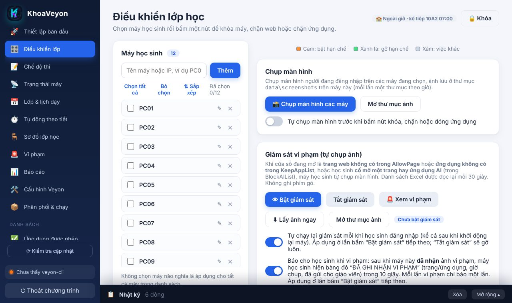
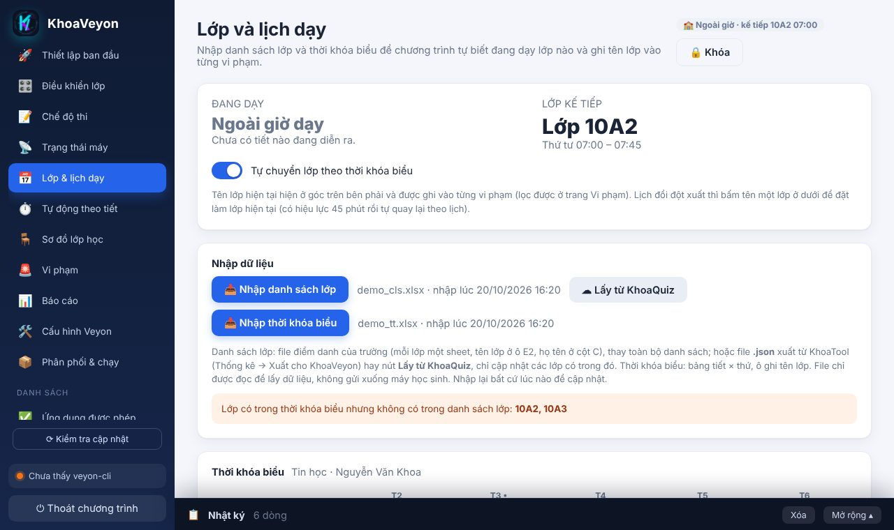
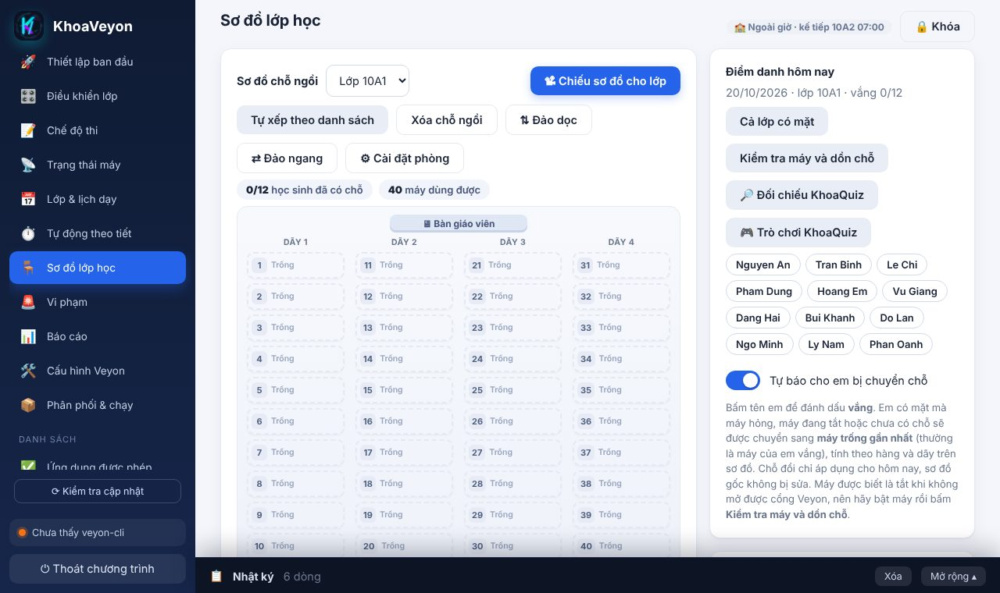
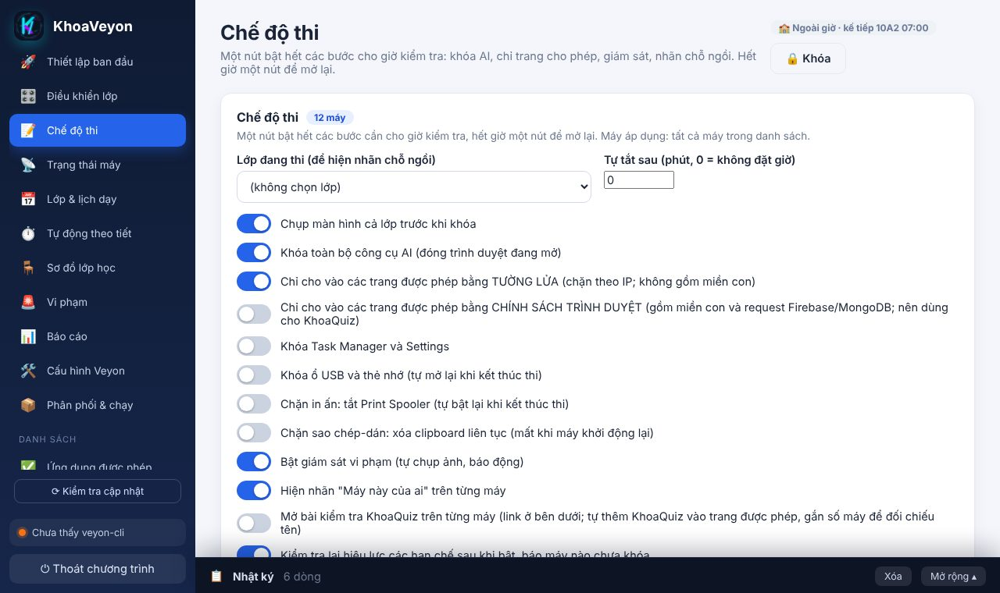
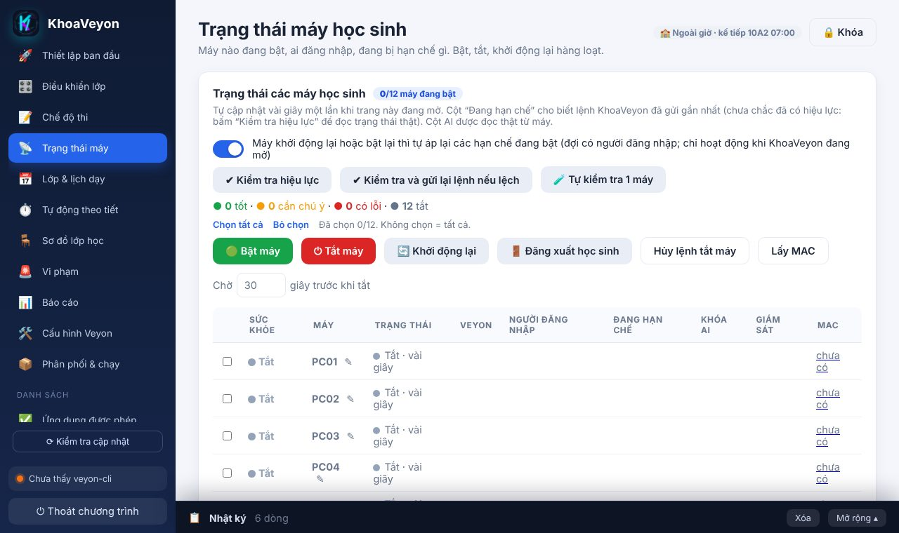

<p align="center"></p>

<h1 align="center">KhoaVeyon</h1>

<p align="center">
  <a href="README.md">English</a> · <b>Tiếng Việt</b><br>
  Bảng điều khiển lớp học cho <a href="https://veyon.io">Veyon</a>: khóa máy, chặn web/ứng dụng/AI, tổ chức thi, điểm danh, theo dõi vi phạm — ngay trên một trang web ở máy giáo viên.
</p>

<p align="center"></p>

> KhoaVeyon không thay thế Veyon. Nó điều khiển Veyon (và Agent nhỏ của riêng mình) qua giao diện dễ dùng hơn.

## Tính năng

| | |
|---|---|
| 🎛️ **Điều khiển lớp** | Một nút để khóa, kiosk, chặn internet / ứng dụng / **công cụ AI**, tắt tiếng, đóng ứng dụng, xóa lịch sử trình duyệt |
| 📝 **Chế độ thi** | Chụp màn hình → khóa AI → chỉ cho trang được phép → khóa cài đặt, gộp trong một công tắc |
| 📡 **Trạng thái & nguồn** | Máy nào bật, ai đăng nhập, đang hạn chế gì; bật / tắt / khởi động lại / đăng xuất |
| 📅 **Tự động theo tiết** | Nhập thời khóa biểu từ Excel; vào tiết tự khóa, hết tiết tự mở |
| 🪑 **Sơ đồ & điểm danh** | Sơ đồ chỗ ngồi theo lớp, học sinh vắng, liên kết KhoaQuiz |
| 🚨 **Giám sát vi phạm** | Tự chụp ảnh khi mở trang/ứng dụng cấm, thư viện bằng chứng, báo cáo |
| 📋 **Danh sách Excel** | Sửa ứng dụng/trang được phép, bị chặn, trang AI bằng bảng; tự gửi xuống máy học sinh |
| 🔌 **Agent** | Máy giáo viên điều khiển máy học sinh không cần tài khoản quản trị, chia sẻ C$ hay Task Scheduler từ xa |

## Cách hoạt động

```
Máy giáo viên ── KhoaVeyon (giao diện web, Python) ──┬─ veyon-cli ───────────► Veyon Service ┐
                                                     └─ Agent (HTTP, cổng 8767) ◄─ dịch vụ KhoaVeyonAutoLog ┤ Máy học sinh
                                                        chạy KhoaVeyonServices.bat bằng SYSTEM / trong phiên học sinh ┘
```

## Bắt đầu nhanh

1. **Máy giáo viên (Windows, đã cài Veyon Master):** chạy `Chay-KhoaVeyon.bat`. Lần đầu sẽ tự tải Python portable nếu máy chưa có.
2. Vào **Thiết lập ban đầu** → **Thiết lập máy giáo viên**, rồi **🔎 Tìm máy học sinh trong mạng**.
3. **Mỗi máy học sinh, một lần:** chép thư mục `payload`, chuột phải `Setup-MayHocSinh.bat` → *Run as administrator*. File này cài Agent, đồng bộ giờ và in bảng `[OK]/[LOI]` (lưu thêm ở `C:\cmd\KhoaVeyonSetup.log`).

Xong: chọn máy ở **Điều khiển lớp** và bấm nút.

## Hình ảnh

| Lớp & thời khóa biểu | Sơ đồ lớp |
|:--:|:--:|
|  |  |
| **Chế độ thi** | **Trạng thái máy** |
|  |  |

## Xử lý sự cố

| Sự cố | Cách xử lý |
|---|---|
| `Invalid feature name or UID` | **Cài đặt → "Nút điều khiển lớp chạy bằng"** chọn *Agent*; không cần mục "Programs & websites" trong Veyon |
| Máy học sinh không có Agent | Kiểm tra giờ/múi giờ máy học sinh (lệch > 15 phút bị từ chối), tường lửa cổng 8767 máy giáo viên, rồi chạy lại `Setup-MayHocSinh.bat`. Lý do hiện ở **Nhật ký** |
| Máy hiện IP thay vì tên | Cần Agent, DNS ngược hoặc NetBIOS; quét lại sau khi cài |
| Nhập thời khóa biểu lỗi | Cần hàng tiêu đề các thứ (`THỨ HAI`, `T2`…) + giờ hoặc số tiết; lỗi hiện ngay trên trang |

## Yêu cầu

Máy giáo viên: Windows 10/11 + [Veyon](https://veyon.io) (Master). Máy học sinh: Windows + Veyon Service + .NET Framework 4. Python đã kèm trong bộ chạy.

## Phát triển

```
python -m unittest discover -s tests
```

Chi tiết: [docs/HUONG-DAN-CHI-TIET.vi.md](docs/HUONG-DAN-CHI-TIET.vi.md) · [README-KhoaVeyon.md](README-KhoaVeyon.md) (lịch sử thay đổi, cấu trúc mã).

> Đã kiểm thử bằng bộ test tự động và giao diện mô phỏng; hoạt động trên máy học sinh thật còn phụ thuộc cài đặt Veyon và mạng của bạn.
